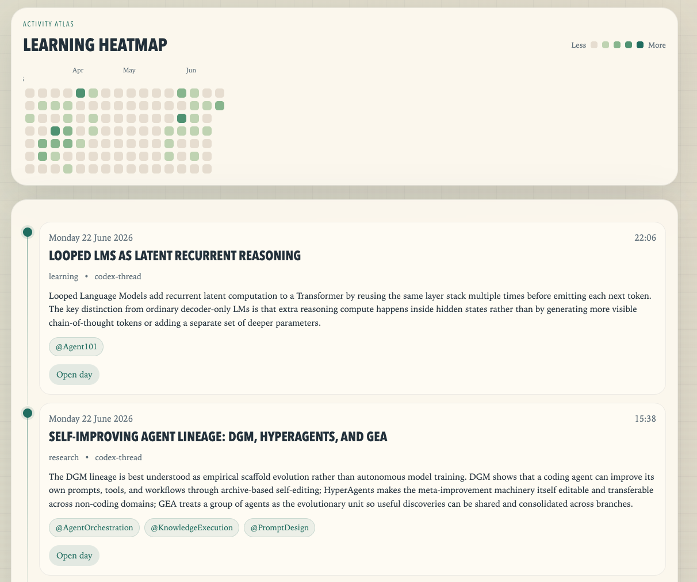

# Agent Skills for AI/ML Research Scientists

This repository collects the Codex skills I have used regularly since January 2026 in my work as an AI/ML scientist in industry. Each skill is designed around a specific recurring workflow where a small amount of prompt structure can make an AI agent much more useful.

For example, `thread-learning-log` helps me capture what I learned from a session so that daily work turns into reusable knowledge, more importantly, encourage me to learn something new each day. `grill-me` helps pressure-test a plan or design by surfacing hidden assumptions, unresolved decisions, and likely limitations before implementation begins.

Link to the Github repository: [https://github.com/tuananhbui89/skills]

## Thread Learning Log

**Motivation**: I want a lightweight way to track what I actually learn while working with AI agents. Today, agents can support many parts of our work, such as reading papers, planning experiments, writing code, debugging, and running evaluations. As a result, we can accomplish much more in a single day than before.

But in my own experience, moving faster does not always feel the same as understanding more deeply. It can feel like the difference between walking somewhere and riding in a self-driving car. When I walk, progress is slower and I may stumble, but the obstacles I encounter force me to observe, reason, and solve problems myself. Knowledge is formed through that friction, and it tends to stay in my mind. In a self-driving car, I may travel much farther, but I can lose the embodied sense that I actually learned the route.

There is also a more personal reason: my memory is not especially reliable. If I do not revisit something, I often forget the details after a while. This is consistent with the idea of the "forgetting curve": without review or reinforcement, knowledge fades over time.

The idea behind this skill is simple: ask an AI agent to review the session or thread we just worked through together and extract durable, reusable lessons that may be useful in the future. For example, after using Codex to read and discuss a research paper, I can ask it to capture the paper's main ideas, assumptions, and takeaways. Or, after solving a difficult bug, I can ask the skill to summarize the debugging path, the root cause, and the fix.

The memory file will be a Markdown document. Each item or section represents one lesson, tagged with a timestamp and the related project or topic.

To make the skill more useful, visible, and easy to revisit, I also want Codex to build a small website from the main memory Markdown file. The UI should look like the image below, inspired by GitHub's commit history. Seeing a daily record of what I have learned and solved should make it easier to return to the log regularly and encourage me to save at least one interesting lesson each day.



## Grill Me

Matt Pocock's [`grilling`](https://github.com/mattpocock/skills/tree/main) skill is a small but powerful example of prompt design. I tried it and found it surprisingly useful, not because the prompt is long or complex, but because it gives the model a clear conversational role: slow the user down, pressure-test the plan, and expose hidden assumptions before implementation begins.

That experience changed how I think about skills. A good skill does not always need a large knowledge base, a complicated toolchain, or many pages of instructions. Sometimes a few carefully chosen sentences are enough to unlock much better behavior from an LLM.

**The skill**

Below is Matt's original `grilling` skill, which is the starting point for my local `grill-me` skill:

```text
---
name: grilling
description: Grill the user relentlessly about a plan or design. Use when the user wants to stress-test a plan before building, or uses any 'grill' trigger phrases.
---

Interview me relentlessly about every aspect of this plan until we reach a shared understanding. Walk down each branch of the design tree, resolving dependencies between decisions one-by-one. For each question, provide your recommended answer.

Ask the questions one at a time, waiting for feedback on each question before continuing. Asking multiple questions at once is bewildering.

If a question can be answered by exploring the codebase, explore the codebase instead.

Do not enact the plan until I confirm we have reached a shared understanding.
```

I modified the skill slightly with Codex, but the core principles remain the same:

- Interview relentlessly, but ask only one question at a time.
- Provide a recommended answer for each question so the user has something concrete to accept, reject, or revise.
- Walk down each branch of the design tree, resolving dependencies between decisions one by one.
- Explore the codebase directly when a question can be answered from local context.

The phrase "walk down each branch of the design tree" feels especially important. It tells the model not to ask random clarification questions, but to treat the plan as a structured set of dependent decisions. Each answer either opens or closes later branches. This is what makes the skill feel closer to a serious architecture review than a normal back-and-forth chat.

**Usage**

Use this skill to stress-test a plan, design, architecture, research direction, or implementation strategy before committing to it. It is especially useful when the problem has unclear requirements, hidden tradeoffs, or decisions that depend on one another.

Its behavior feels related to Plan mode in Codex: both ask clarifying questions and often provide recommended answers. The difference is intensity and depth. Plan mode usually asks only a small number of questions before moving toward execution. `grill-me` can keep going for much longer, which makes it better for uncovering unknown-yet-important details. I have often been surprised by the questions it raises, because they reveal assumptions I did not realize were part of the plan.

## Ask Me Paper

This skill was inspired by `grill-me`, but adapts the same interview-driven pattern to one of my most important workflows: reading academic papers and technical articles.

One reading principle I try to follow is active hypothesis testing:

- Before reading, and while reading, I form hypotheses and questions about the problem setting, assumptions, method, evidence, and limitations.
- Reading becomes the process of looking for answers to those hypotheses and questions.
- I should stop only when I can make a clear judgment: the paper addresses the question, the paper does not address it, or the answer remains uncertain.

This skill tries to recreate that discipline with Codex. Instead of letting me passively read a summary, Codex first reads the supplied paper or article, builds an internal understanding map, and then interviews me with rigorous four-choice multiple-choice questions. The goal is not to collect trivia from the paper. The goal is to check whether I understand the paper's central argument, how its claims depend on its evidence, what assumptions the method makes, and where the limitations are.

**The skill**

The core behavior of `ask-me-paper` is:

- Read the supplied paper or article before asking questions.
- Stay grounded in the source unless I explicitly ask for external context.
- Build an understanding map covering the thesis, claims, evidence, methods, definitions, assumptions, limitations, implications, and open questions.
- Ask exactly one multiple-choice question at a time, with four options labeled `A.` to `D.`.
- Make the distractors plausible and diagnostic, so wrong answers reveal specific misunderstandings rather than random mistakes.
- After each answer, classify it as correct, partial, unsupported, or wrong.
- Correct misunderstandings with concise evidence from the source before moving on.
- Continue until the main concepts have been tested or I ask to pause.

This is important because good paper reading is not just "Can I repeat the abstract?" It is closer to "Can I distinguish the paper's actual claim from a tempting stronger claim? Can I explain why the method is appropriate? Can I see what the evidence does and does not prove?" Multiple-choice questions are useful here because they force commitment. I cannot hide behind vague familiarity; I have to pick an interpretation.

**Usage**

Use this skill when I have a paper, article, PDF, excerpt, or pasted text and want to test whether I really understand it. A typical prompt is:

```text
Use $ask-me-paper on this paper and quiz me one question at a time.
```

It is useful in several moments:

- before a deep read, to surface what the paper is probably about and what I should pay attention to
- after a first read, to check whether I understood the main argument
- before a meeting or discussion, to make weak points visible
- when reading a difficult method section, to separate real understanding from recognition of familiar terms
- after using an AI agent to summarize a paper, to make sure I did not only outsource the understanding

The most valuable behavior is correction. If I choose the wrong answer, the skill should not simply reveal the correct option and move on. It should explain the misconception, point back to the paper's evidence or logic, and ask a targeted follow-up question when the misunderstanding affects later understanding. That turns paper reading into an active loop: commit, get corrected, refine the model, and continue.

## YouTube Transcript

I often learn from YouTube tutorials, talks, and walkthroughs, but many of them are long. A useful video can easily be 30 minutes or more, and my attention usually fades very soon. Therefore, it comes very naturally with the need of a co-study partner: extract the transcript, summarize the structure, and help me decide where to spend my attention.

This skill exists for that workflow. It uses a Python helper built around `youtube-transcript-api` to fetch a transcript from a YouTube URL or video ID, save the transcript in the current workspace, and then produce a concise summary of the video's content. Having the transcript as a local text file is also useful because it turns a video into something searchable, quotable, and easy to revisit later.

**The skill**

The core behavior of `youtube-transcript` is:

- Accept common YouTube URL formats, including normal watch links, `youtu.be` links, Shorts, embeds, live URLs, and playlist URLs that contain a video parameter.
- Fetch the transcript through `scripts/get_transcript.py`.
- Save the transcript as a `.txt` file in the current workspace unless another destination is requested.
- Report useful metadata, including the output path, video ID, transcript language, whether it was auto-generated, and any fallback behavior.
- Read the saved transcript and summarize the video's main ideas concisely.
- Clearly explain limitations when transcripts are unavailable, the video is private or restricted, or request blocking prevents extraction.

**Usage**

Use this skill when I have a YouTube video and want to study it more efficiently. A typical prompt is:

```text
Use $youtube-transcript to fetch the transcript for this video and summarize it: <YouTube URL>
```

It is useful for:

- long tutorials where I want the main steps before deciding what to watch carefully
- technical talks where I want the argument, examples, and conclusions in text form
- coding walkthroughs where I want to search for specific commands, APIs, or design decisions
- lectures or interviews where I want a compact study note before deeper review
- saving useful video content into a workspace so it can be referenced by later Codex sessions

The important point is that this skill turns video learning into text-first learning. Once the transcript is saved, I can ask follow-up questions, extract checklists, compare claims, turn the content into notes, or pass the transcript into another skill such as `ask-me-paper` or `thread-learning-log`.

## Lazy-reader

**Motivation**: I want to reduce the time needed to read and understand a paper without losing the details that a short summary usually omits. Important observations, weaknesses, limitations, experimental details, and future directions are often buried in an appendix or a single easy-to-miss paragraph. I want a compact but faithful mini version of the paper, not merely a handful of key points.

**The skill**

`lazy-reader` creates exhaustive reading notes for arXiv papers. It downloads and expands the paper source, reads the paper section by section, and writes a Markdown note that mirrors the paper's structure. The note captures the motivation, method, evidence, experiments, limitations, and open questions with concrete details rather than vague paraphrases. When useful, it places the paper's figures and tables alongside the explanation they support, then produces a standalone HTML version for easier review.

**Usage**

```text
Use $lazy-reader to create detailed Markdown and HTML reading notes for this paper: <arXiv URL or ID>
```

It is most useful when I want a durable study artifact for a paper, need to inspect experimental details or appendices, or want to revisit a paper without rereading it from scratch.

## Research-blog-writer

**Motivation**: I want a framework that researches a topic from selected high-quality sources, such as OpenAI, Anthropic, Google Research, Hugging Face, and primary papers or specifications, then turns that research into a strong blog-post draft. The aim is to create a living learning wiki: a well-structured starting point that I can enrich over time when I discover useful related material.

**The skill**

`research-blog-writer` researches a topic before drafting a grounded, technical Markdown post. It begins with first principles for readers with programming literacy, then moves through concepts and implementation-level engineering detail: architecture, APIs, data and control flow, tradeoffs, failure modes, evaluation, and operational concerns. It checks current, preferably primary sources; uses inline citations for specific claims; and finishes with a complete references section. For agentic-AI topics, it can also use the local *Hitchhiker's Guide to Agentic AI* as supporting context while keeping current web research mandatory.

**Usage**

```text
Use $research-blog-writer to research <topic> and draft a layered Markdown post with deep engineering detail, inline citations, and references.
```

This is useful for turning a broad topic or one section of an outline into an accurate, extensible technical article rather than a one-off surface-level summary.

### arxiv-tex-crawler

**Motivation**: This supporting skill downloads the TeX source for an arXiv paper. Having the original source gives me access to the figures, tables, and structured content, so I can create a faithful mini version of the paper instead of working only from a PDF.

**The skill**

`arxiv-tex-crawler` accepts an arXiv URL or ID, normalizes it to the source package, downloads it, and safely extracts the package into a local directory. It handles common source formats and reports useful failures, such as a missing or PDF-only source package.

**Usage**

```text
Use $arxiv-tex-crawler to download and unpack the source for: <arXiv URL or ID>
```

### Illustrator-planner and Illustrator-drawer

**Motivation**: These supporting skills help me identify illustrations that will genuinely improve a blog post, then turn an approved plan into an accessible figure. The goal is to add visuals that clarify difficult ideas rather than decoration.

I borrow some ideas from:

- [https://developers.google.com/tech-writing/two/illustrations](https://developers.google.com/tech-writing/two/illustrations)
- algorithmic-art from Anthropic at [https://github.com/anthropics/skills/blob/main/skills/algorithmic-art/SKILL.md](https://github.com/anthropics/skills/blob/main/skills/algorithmic-art/SKILL.md)

**The skill**

`illustrator-planner` reads a document and recommends the smallest useful set of figures. Each recommendation is an implementation-ready `Illustration Request v1` that defines the learning objective, source claim, composition, visual hierarchy, connector semantics, caption, alt text, and acceptance criteria. `illustrator-drawer` uses that approved request to produce an original, static SVG with a responsive embed snippet, then checks the result for readable labels, clear relationships, and accurate connectors.

**Usage**

```text
Use $illustrator-planner to identify the highest-value illustrations for this draft: <path or pasted Markdown>
```

Then pass an approved request to the drawing skill:

```text
Use $illustrator-drawer to create the SVG for this Illustration Request v1: <request>
```

### Markdown-to-html

**Motivation**: This is a supporting skill. I prefer Markdown as the editable source, but reviewing a long document in plain Markdown is limited. A standalone HTML article is more comfortable to read and easier to review.

**The skill**

`markdown-to-html` converts a local Markdown file into a self-contained HTML article while leaving the Markdown unchanged. The generated file has embedded styling, semantic article structure, heading anchors, a responsive table of contents, and support for tables, lists, links, citations, and fenced code blocks. It has no external CSS, JavaScript, fonts, or build requirement.

**Usage**

```text
Use $markdown-to-html to convert this Markdown file into a standalone HTML article: <path-to-file.md>
```
